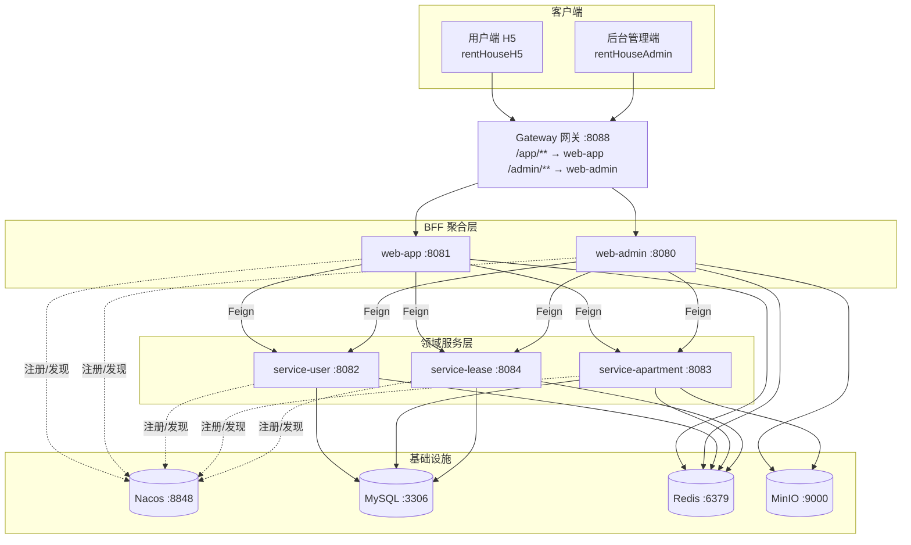

长租公寓租赁平台

一个面向长租公寓业务的前后端分离项目，包含 **用户端 H5**、**后台管理端** 与 **Spring Cloud 微服务后端**，覆盖房源浏览、在线预约、电子签约、租约管理、房屋评价（圈子）等完整业务闭环。

## 项目简介

平台围绕「找房—看房—签约—租后」主线设计，用户可通过 H5 端浏览公寓与房间、提交预约看房、查看并签署租赁协议、在圈子中发布房屋评价并点赞评论；管理端则负责公寓、房间、属性字典、租约、预约、用户及系统权限的维护。

后端采用微服务架构，按业务域拆分为用户、公寓、租约三个领域服务，网关统一入口，Web 层作为面向客户端的 BFF 聚合层通过 Feign 调用下游服务。

## 功能特性

### 用户端（rentHouseH5）
- **找房**：按区域、租金、排序等条件检索公寓与房间
- **房源详情**：公寓详情、房间详情、配套设施、图片展示
- **在线预约**：提交预约看房、查看我的预约
- **我的房间**：查看当前租住的房间信息
- **我的租约**：查看租赁协议列表、协议详情、在线签约
- **圈子（评价社区）**：
  - 查看所有人发布的房屋评价信息流
  - 对评价点赞（Redis ZSet 原子计数）、评论
  - 评价与评论均支持「最新 / 最热」排序
- **我的评价**：查看本人发布过的评价，支持排序、删除自己的评论
- **发布评价**：租约页面对已签约 / 已到期 / 已退租的房屋发布图文评价
- **消息**：站内消息通知
- **个人中心**：账号信息、浏览历史、退出登录

### 管理端（rentHouseAdmin）
- **公寓管理**：公寓的增删改查、上下架
- **房间管理**：房间信息维护、房间属性配置
- **属性字典管理**：标签、费用、设施、付款方式、租期、房间基础属性
- **租约管理**：租约列表、租约变更、签约状态管理
- **预约管理**：预约看房记录查询与处理
- **用户管理**：平台用户信息维护
- **系统管理**：后台账号、岗位管理

## 技术栈

### 后端
| 技术 | 版本 / 说明 |
| --- | --- |
| JDK | 17 |
| Spring Boot | 3.0.5 |
| Spring Cloud | 2022.0.4 |
| Spring Cloud Alibaba | 2022.0.0.0（Nacos 注册/配置中心） |
| Spring Cloud Gateway | 统一网关路由 |
| OpenFeign | 服务间调用（BFF 聚合领域服务） |
| MyBatis-Plus | 3.5.3.1 |
| MySQL | 8.x |
| Redis | 缓存、验证码、点赞计数与热榜（ZSet） |
| Knife4j | 4.1.0（OpenAPI3 接口文档） |
| JJWT | 0.11.2（登录鉴权） |
| MinIO | 8.2.0（图片等非结构化数据存储） |
| Aliyun SMS | 短信验证码 |
| EasyCaptcha | 图形验证码 |

### 前端
| 端 | 技术 |
| --- | --- |
| 用户端 H5 | Vue 3 + Vite 4 + TypeScript + Vant 4 + Pinia + Vue Router + TailwindCSS + Less |
| 管理端 | Vue 3 + Vite 4 + TypeScript + Element Plus + ECharts + Pinia + Vue Router |

## 系统架构



### 设计约定
- **三层架构**：网关只做路由转发，Web 层（BFF）只做接口聚合与 Feign 调用，不做数据库访问；领域业务全部下沉到 `service-*` 服务。
- **数据隔离**：Web 层无持久层代码，数据只由领域服务通过 MyBatis-Plus 读写。
- **Feign 规范**：每个 Feign 客户端使用唯一 `contextId` 防止 Bean 名冲突；返回值使用具体 `Page` 类而非 `IPage` 抽象类以避免跨服务反序列化失败；GET 多参数方法使用 `@SpringQueryMap` 避免被转换为 POST。
- **鉴权**：JWT + 拦截器，登录用户信息存于 `LoginUserHolder`（ThreadLocal）。
- **点赞与热榜**：评价 / 评论点赞基于 Redis ZSet 的 `ZINCRBY` 原子命令计数，利用 score 排序高效获取 TopN 热帖，避免高并发下频繁写库。

## 项目结构

```
project/
├── lease/                       # 后端微服务工程
│   ├── common/                  # 公共模块
│   │   ├── common-util/         # 通用工具（Result、JWT、登录上下文、异常、常量）
│   │   └── service-util/        # 服务层通用配置（MyBatis-Plus、Redis、MinIO、短信、全局异常）
│   ├── model/                   # 实体、VO、枚举等共享模型
│   ├── api/                     # 各领域服务对外暴露的 Feign 客户端
│   ├── gateway/                 # Spring Cloud Gateway 网关（:8088）
│   ├── service/                 # 领域服务层
│   │   ├── service-user/        # 用户域（:8082）
│   │   ├── service-apartment/   # 公寓域（:8083）
│   │   └── service-lease/       # 租约域，含评价/评论模块（:8084）
│   └── web/                     # BFF 聚合层
│       ├── web-admin/           # 后台管理端接口（:8080）
│       └── web-app/             # 用户端接口（:8081）
├── rentHouseAdmin/              # 后台管理端前端（Vue3 + Element Plus）
├── rentHouseH5/                 # 用户端 H5 前端（Vue3 + Vant）
├── 评价模块建表脚本.sql          # 评价/评论相关建表语句
└── 评价模块接口文档.md           # 评价/评论模块接口说明
```

## 环境要求

- JDK 17
- Maven 3.8+
- Node.js >= 16
- MySQL 8.x
- Redis 6.x
- Nacos 2.x
- MinIO（可选，图片上传功能依赖）

## 快速开始

### 1. 启动基础设施

按顺序确保以下服务可用（默认地址见「配置说明」）：

1. MySQL，并导入数据库 `lease`（含业务表与评价模块建表脚本）
2. Redis
3. Nacos（默认 `192.168.100.101:8848`）
4. MinIO（约定 `9000` 端口）

### 2. 启动后端

在 `lease/` 目录下，先构建公共模块，再按依赖顺序启动服务：

```bash
# 在项目根目录构建全部模块
mvn -DskipTests clean install

# 依次启动（建议顺序）
# 1. 网关
java -jar gateway/target/*.jar
# 2. 领域服务
java -jar service/service-user/target/*.jar
java -jar service/service-apartment/target/*.jar
java -jar service/service-lease/target/*.jar
# 3. BFF 聚合层
java -jar web/web-admin/target/*.jar
java -jar web/web-app/target/*.jar
```

也可在 IDE 中直接运行各模块的 `*Application` 主类（需先 `mvn install` 安装公共模块）。

> 注意：所有微服务均依赖 Nacos，若 Nacos 未启动或不可达，应用启动会因注册失败而报错。

### 3. 启动前端

```bash
# 用户端 H5
cd rentHouseH5
npm install
npm run dev          # 开发环境，默认 http://localhost:5173

# 后台管理端
cd rentHouseAdmin
npm install
npm run dev          # 开发环境
```

前端通过 Vite 代理将 `/app`、`/admin` 请求转发至对应后端服务（见各端 `.env.*` 中 `VITE_APP_BASE_URL` 与 `vite.config.ts`）。

### 4. 构建生产包

```bash
# 用户端
cd rentHouseH5 && npm run build

# 管理端
cd rentHouseAdmin && npm run build
```

## 配置说明

各服务配置文件位于 `lease/**/src/main/resources/application.yml`，主要配置项：

| 配置项 | 说明 |
| --- | --- |
| `spring.cloud.nacos.discovery.server-addr` | Nacos 地址 |
| `spring.datasource.url / username / password` | MySQL 连接 |
| `spring.data.redis.host / port` | Redis 连接 |
| `minio.endpoint / access-key / secret-key / bucket-name` | MinIO 对象存储 |
| `aliyun.sms.access-key-id / access-key-secret` | 阿里云短信 |
| `server.port` | 各服务端口 |

> **安全提示**：请勿将数据库密码、MinIO/阿里云 AccessKey 等敏感信息提交到版本库。建议本地使用 `application-local.yml` 或环境变量注入，并将其加入 `.gitignore`。

## 接口文档

后端集成 Knife4j（OpenAPI3）。启动对应服务后访问：

- 网关聚合文档：`http://localhost:8088/doc.html`
- 单服务文档：如用户服务 `http://localhost:8082/doc.html`

评价/评论模块的完整接口说明见 [评价模块接口文档.md](./评价模块接口文档.md)。

## 数据库

- 主库：`lease`
- 评价模块建表语句：[评价模块建表脚本.sql](./评价模块建表脚本.sql)

包含评价、评价图片、评价点赞、评论、评论点赞等表，点赞表通过唯一索引防止重复点赞。

## 常见问题

- **启动报 Nacos `UNHEALTHY` / 连接失败**：确认 Nacos 已启动且地址可达，所有服务均依赖它。
- **Feign 405 Method Not Allowed**：GET 多参数 Feign 方法需加 `@SpringQueryMap`。
- **Feign 返回值反序列化失败**：返回类型需使用具体 `Page` 类，不能用 `IPage`。
- **Bean 名称冲突 / 启动失败**：每个 Feign 客户端需指定唯一 `contextId`。
- **推送 GitHub 连接重置**：HTTPS 推送网络不稳时，可为 git 配置本地代理（见 `git-proxy-on.bat` / `git-proxy-off.bat`），或改用 SSH 远程。

## 说明

本项目为教学实践项目，用于演示 Spring Cloud 微服务架构、前后端分离与 Redis 高并发场景（点赞/热榜）的落地实现。
